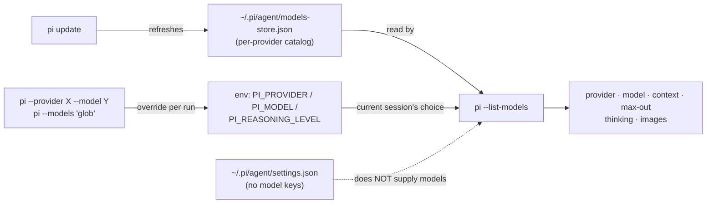

Asked "models", the right move here is the harness command `pi --list-models` (optionally `pi --list-models <fuzzy-search>`). It prints provider, model id, context window, max output, and whether thinking and image input are supported. Do not try to reconstruct the list from `~/.pi/agent/settings.json` — that file only holds `extensionChangelogVersions`, `lastChangelogVersion` and `packages`, so a `jq` for defaultProvider/defaultModel/models/thinkingLevel returns all nulls and says nothing about what exists.

## Where the data actually lives

- Model catalog: `~/.pi/agent/models-store.json` — a per-provider map (`jq -r keys` → e.g. `lunaroute`). `pi update` refreshes model catalogs; it is fetched data, not project config.
- Runtime choice: the `PI_PROVIDER` / `PI_MODEL` / `PI_REASONING_LEVEL` environment variables of the running session (e.g. `lunaroute` / `deepseek-4.1-flash` / `medium`). Read them with `env | grep '^PI_'`; they reflect this session, not a saved default.
- Override per run with `pi --provider <name> --model <pattern>` (pattern accepts `provider/id` and a `:<thinking>` suffix) or `pi --models <globs>` to set what Ctrl+P cycles through.

## Gotcha

`pi --help` has no `models` subcommand — the flag is `--list-models`. `pi update` is the command that touches catalogs.
