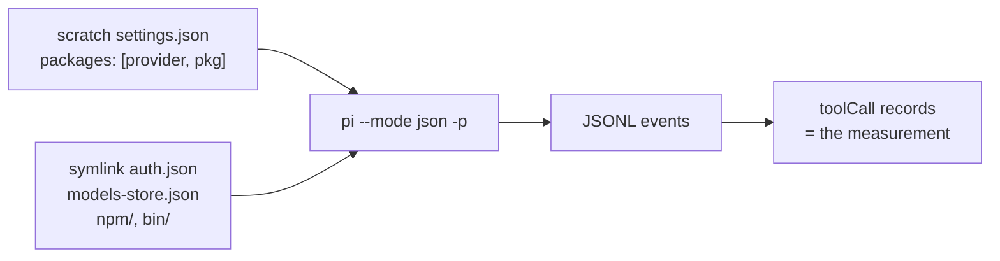

To test whether a model actually reaches for the tools a package provides, run pi with `PI_CODING_AGENT_DIR` pointing at a scratch directory whose `settings.json` lists only that package, then parse the JSON event stream for tool calls. Run against the real agent dir and other installed extensions will answer for you, which invalidates the test.

The scratch profile needs four things linked in or pi finds no models: `auth.json` and `models-store.json` (credentials and catalog), `npm/` (the provider itself is an extension package, e.g. `npm:@lunaroute/pi-extension`), and `bin/` (so the managed-tool extension sees tools present instead of downloading all 25).



## Recipe

```sh
mkdir -p /tmp/probe/agent
cat > /tmp/probe/agent/settings.json <<'EOF'
{ "packages": ["npm:@lunaroute/pi-extension", "/abs/path/to/package"],
  "defaultTools": ["read","bash","edit","write","+grep","+find"] }
EOF
for f in auth.json models-store.json npm bin; do ln -sfn ~/.pi/agent/$f /tmp/probe/agent/$f; done
PI_CODING_AGENT_DIR=/tmp/probe/agent pi --mode json -p "your probe prompt" > out.jsonl
```

Repeat each probe: one run per prompt, and re-run the same prompt after changing the skill text — that before/after pair is the only evidence that guidance actually changed behaviour.
